# UTEP-EMR Architecture, Sitemap, User Flows & UX Analysis

> **Repository State:** `main` (`1bba0a6`)  
> **Scope:** Full directory analysis, state-router sitemap & Mermaid flowchart, end-to-end user flows, shared data context matrix, multi-click navigation bottlenecks, and UX refactoring recommendations.

---

## 1. Project Directory Analysis

```text
UTEP-EMR/
├── frontend/src/
│   ├── App.jsx                        # Root state router (nav.page) & auth/role gatekeeper
│   ├── pages/                         # 21 top-level & embedded view components
│   ├── components/                    # Shared UI, modals, & clinical form widgets
│   │   ├── patient-chart/             # Sub-tabs for PatientChart (Summary, Allergies/History, Medications, Diagnoses, ICD-10)
│   │   ├── vitals/                    # VitalsPanel (Form, Trends SVG chart, History table)
│   │   └── diagnostics/               # DiagnosticsPanel (Labs & Imaging orders/results)
│   ├── services/                      # 15 Supabase & FastAPI data client modules
│   ├── lib/                           # Rubric grading math (grading.js) & CSV parser (studentImport.js)
│   └── data/                          # Static catalogs (medicines.json, diagnosticsCatalog.json)
├── backend/
│   ├── app/
│   │   ├── main.py                    # FastAPI entry point (/api/v1)
│   │   ├── routers/                   # medications.py (safety check), diagnostics.py (catalog)
│   │   ├── services/                  # medication_safety.py, openfda.py, diagnostics.py
│   │   └── data/                      # Drug interaction rules & diagnostics catalog JSON
│   └── tests/                         # Pytest backend test suites
├── supabase/
│   ├── functions/                     # 4 Deno Edge Functions (create-patient-account, create-student, enroll-in-course, manage-students)
│   └── migrations/                    # 42 PostgreSQL schema & RLS migration files
├── tests/                             # Playwright & Node (.mjs) integration/E2E verification scripts
└── docs/ & customer_context/          # Architecture docs, database ERDs, & stakeholder notes
```

### Routing Mechanism (`frontend/src/App.jsx`)
Instead of URL path routing (`react-router-dom`), `App.jsx` uses an **in-memory state router** (`const [nav, setNav] = useState({ page: "dashboard", id: null })`) mutated via `navigate(page, id, extra)`. Every screen renders at browser URL `/`.

---

## 2. Sitemap & Route Flowchart

### Visual Route & View Flowchart

```mermaid
flowchart TD
    Root["Browser URL: / (App.jsx)"] --> AuthGate{"Authenticated?"}
    AuthGate -- "No" --> Login["Login.jsx"]
    AuthGate -- "Yes: must_change_password" --> ChangePwd["ChangePassword.jsx"]
    AuthGate -- "Yes: account_type == patient" --> Portal["PatientPortal.jsx"]

    Portal --> PortalTabs["Sidebar Tabs:<br/>1. My Health<br/>2. Medications & Prescriptions<br/>3. Lab Results<br/>4. Last Visit Summary<br/>5. My Profile"]

    AuthGate -- "Yes: Admin / Instructor / Student" --> Shell["Staff & Student Shell<br/>(Header.jsx + Navbar.jsx)"]

    %% Top-level pages from Navbar / Dashboard
    Shell --> Dash["nav.page: 'dashboard'<br/>(Dashboard.jsx)"]
    Shell --> PM["nav.page: 'patientManager'<br/>(PatientManager.jsx)<br/>[Admin, Instructor]"]
    Shell --> SM["nav.page: 'studentManagement'<br/>(StudentManagement.jsx)<br/>[Admin, Instructor]"]
    Shell --> Courses["nav.page: 'courses'<br/>(StudentCourses.jsx)<br/>[Admin, Instructor, Student]"]
    Shell --> PL["nav.page: 'patientLookup'<br/>(PatientLookup.jsx)<br/>[Student]"]
    Shell --> SC["nav.page: 'studentCases'<br/>(StudentCases.jsx)<br/>[Student Dashboard Card]"]

    %% Patient Manager Branch
    PM --> RegModal["Modal: PatientRegistrationForm.jsx"]
    PM --> PDModal1["Modal: PatientDetail.jsx"]
    PM --> PC["nav.page: 'patientChart'<br/>(PatientChart.jsx)"]
    PDModal1 --> PortalMgmt["Modal: PatientPortalManagement.jsx"]
    PDModal1 --> PC

    %% Patient Chart Tabs
    PC --> PCTabs["Chart Sub-Tabs:<br/>• Summary (PatientSummary + Vitals + Diagnostics)<br/>• Allergies/History (PatientAllergiesHistory)<br/>• Medications (PatientMedications)<br/>• Vitals (VitalsPanel: Form / Trends / History)<br/>• Labs & Imaging (DiagnosticsPanel)<br/>• Diagnoses (PatientDiagnoses + Icd10Search)<br/>• Referrals (ReferralManager)<br/>• Notes / Visits [Placeholders]"]

    %% Student Management Branch
    SM --> SDir["StudentDirectory.jsx -> StudentRow.jsx"]
    SM --> BulkCSV1["BulkStudentImport.jsx"]

    %% Courses Branch (Admin / Instructor vs Student)
    Courses --> CourseForm["Modal: CourseForm.jsx<br/>(includes BulkStudentImport.jsx)"]
    Courses -- "Instructor / Admin Click" --> CDetail["nav.page: 'courseDetail'<br/>(CourseDetail.jsx)"]
    Courses -- "Student Click" --> SCDetail["nav.page: 'studentCourseDetail'<br/>(StudentCourseDetail.jsx)"]

    %% Instructor Course Detail Sub-views
    CDetail --> CDHome["Tab: Home<br/>(Roster / Cases / Gradebook Summary)"]
    CDetail --> CDRoster["Tab: Roster<br/>(Enroll / Remove Students)"]
    CDetail --> CDCases["Tab: Cases<br/>(Embedded InstructorCases.jsx)"]
    CDetail --> CDGradebook["Tab: Gradebook"]
    CDetail --> CDSettings["Tab: Settings"]
    CDetail --> PDModal2["Modal: PatientDetail.jsx"]

    CDGradebook --> GBStudentModal["Modal: Gradebook Student Drill-Down"]
    GBStudentModal --> CDGradeModal["Modal: Case Review & Rubric Grading<br/>(Inline in CourseDetail.jsx)"]

    %% Embedded or Standalone InstructorCases
    CDCases --> ICPicker["Modal: Select a Patient Picker"]
    CDCases --> ICRosterModal["Modal: Case Student Roster"]
    CDCases --> TB["Embedded or nav.page: 'templateBuilder'<br/>(TemplateBuilder.jsx)"]
    CDCases --> CA["Embedded or nav.page: 'caseAssign'<br/>(CaseAssign.jsx)"]

    ICRosterModal --> ICGradeModal["Modal: Case Review & Rubric Grading<br/>(Inline in InstructorCases.jsx)"]
    ICRosterModal --> ICAuditModal["Modal: Case Audit Log"]
    ICRosterModal --> PC

    %% Template Builder Wizard
    TB --> TBSteps["4-Step Wizard:<br/>1. Scenario & Metadata<br/>2. Patient Chart (Embedded PatientChart.jsx)<br/>3. Traps & Clinical Note Template<br/>4. Review & Save"]

    %% Student Course Detail & Cases Branch
    SCDetail --> SCDHome["Tab: Home"]
    SCDetail --> SCDCases["Tab: Cases<br/>(Embedded StudentCases.jsx)"]
    SCDetail --> SCDGradebook["Tab: Gradebook<br/>(Scores, Feedback, Annotations)"]

    SCDCases --> ActiveCase["Inline View: Active Case Encounter<br/>(StudentCases.jsx)"]
    SC --> ActiveCase
    ActiveCase --> ToggleChart["Toggle: Embedded PatientChart.jsx<br/>(Show Chart / Hide Chart)"]
    ActiveCase --> SoapForm["PTSoapNote.jsx or<br/>DynamicClinicalNoteForm.jsx"]

    %% Student Patient Lookup Branch
    PL --> SPD["nav.page: 'studentPatientDetail'<br/>(StudentPatientDetail.jsx)"]
    SPD --> Appts["nav.page: 'appointments'<br/>(Appointments.jsx)"]
    SPD --> PC
```



---

### Hierarchical Route & View Sitemap

#### A. Authentication & Patient Portal Gates (`frontend/src/App.jsx`)
* **Unauthenticated** → `Login.jsx` (Sign In + Forgot Password modal)
* **`must_change_password === true`** → `ChangePassword.jsx`
* **`account_type === "patient"`** → `PatientPortal.jsx`
  * **Tab 1 (`dashboard`):** My Health (Vitals cards, active conditions, allergies, recent visits)
  * **Tab 2 (`medications`):** Medications & Prescriptions (active/discontinued filter + OpenFDA drug info lookup)
  * **Tab 3 (`labs`):** Lab Results (pending/completed diagnostic orders & results)
  * **Tab 4 (`visit-summary`):** Last Visit Summary (discharge instructions, diagnosis, follow-up)
  * **Tab 5 (`profile`):** My Profile (read-only demographics + editable phone/address/emergency contact)

#### B. Staff & Student Shell (`account_type` in `["admin", "instructor", "student"]`)
1. **`nav.page = "dashboard"`** → `Dashboard.jsx`
   * Role-aware quick-access cards (`patientManager`, `studentManagement`, `courses`, `patientLookup`, `studentCases`).
2. **`nav.page = "patientManager"`** → `PatientManager.jsx` *(Admin, Instructor)*
   * **Modal:** `+ Add New Patient` → `PatientRegistrationForm.jsx`
   * **Modal:** `View` → `PatientDetail.jsx` → nested **Modal:** `PatientPortalManagement.jsx`
3. **`nav.page = "patientDetail"`** → `PatientDetail.jsx` *(Standalone route registered in `App.jsx`, though now primarily opened as a modal inside `PatientManager` and `CourseDetail`)*
4. **`nav.page = "patientChart"`** → `PatientChart.jsx` *(Supports `patientId`, `caseId`, `templateId`, and `embedded` modes)*
   * **Sub-Tab `Summary`:** `PatientSummary.jsx` + embedded `VitalsPanel.jsx` + embedded `DiagnosticsPanel.jsx`
   * **Sub-Tab `Allergies/History`:** `PatientAllergiesHistory.jsx`
   * **Sub-Tab `Medications`:** `PatientMedications.jsx` + `MedicationSelector.jsx`
   * **Sub-Tab `Vitals`:** `VitalsPanel.jsx` (`VitalsForm.jsx`, `VitalsTrends.jsx`, `VitalsHistory.jsx`)
   * **Sub-Tab `Labs & Imaging`:** `DiagnosticsPanel.jsx`
   * **Sub-Tab `Diagnoses`:** `PatientDiagnoses.jsx` + `Icd10Search.jsx`
   * **Sub-Tab `Referrals`:** `ReferralManager.jsx`
   * **Sub-Tabs `Notes` & `Visits`:** Placeholder screens (`"Notes is coming soon."` / `"Visits is coming soon."`)
5. **`nav.page = "studentManagement"`** → `StudentManagement.jsx` *(Admin, Instructor)*
   * Renders Single Student Creation Form, `BulkStudentImport.jsx`, and `StudentDirectory.jsx` (`StudentRow.jsx`).
6. **`nav.page = "courses"`** → `StudentCourses.jsx` *(All Staff/Student roles)*
   * **Modal (Admin/Instructor):** `+ New Course` → `CourseForm.jsx` (with embedded `BulkStudentImport.jsx`)
   * **Modal (Student):** `Join Course` (Enrollment code input)
7. **`nav.page = "courseDetail"`** → `CourseDetail.jsx` *(Admin, Instructor)*
   * **Sidebar Tabs:** `Home`, `Roster`, `Cases` (embeds `InstructorCases.jsx`, `TemplateBuilder.jsx`, `CaseAssign.jsx`), `Gradebook` (opens **Gradebook Student Modal** → **Grading Modal**), `Announcements` *(disabled)*, `Settings`.
8. **`nav.page = "studentCourseDetail"`** → `StudentCourseDetail.jsx` *(Student)*
   * **Sidebar Tabs:** `Home`, `Cases` (embeds `StudentCases.jsx`), `Gradebook` (scores, feedback, chart annotations), `Announcements` *(disabled)*.
9. **`nav.page = "instructorCases"`** → `InstructorCases.jsx`
   * **Modals:** `From Patient` Picker Modal, `Student Roster` Case Group Modal, `Case Review / Grading` Modal, `Case History / Audit Log` Modal.
10. **`nav.page = "templateBuilder"`** → `TemplateBuilder.jsx` (4-step wizard; Step 2 embeds `PatientChart.jsx`).
11. **`nav.page = "caseAssign"`** → `CaseAssign.jsx`
12. **`nav.page = "studentCases"`** → `StudentCases.jsx`
    * **Inline Sub-View (`activeCase`):** Full-page Case Encounter workspace with toggleable embedded `PatientChart.jsx` (`Show Chart` / `Hide Chart`), read-only Patient & Medical Info cards, and clinical note editor (`PTSoapNote.jsx` or `DynamicClinicalNoteForm.jsx`).
13. **`nav.page = "patientLookup"`** → `PatientLookup.jsx` *(Student)*
14. **`nav.page = "studentPatientDetail"`** → `StudentPatientDetail.jsx` *(Student)*
15. **`nav.page = "appointments"`** → `Appointments.jsx` *(Only reachable from `StudentPatientDetail.jsx`)*

> [!WARNING]
> **Orphaned & Semi-Orphaned Views Identified in Codebase**
> 1. **`Patients.jsx`:** Completely orphaned. Not imported in `App.jsx`; superseded by `PatientManager.jsx` and `PatientLookup.jsx`.
> 2. **Standalone `nav.page = "instructorCases"` (`InstructorCases.jsx`):** In commit `1bba0a6`, the Instructor Dashboard "Case Management" card (`Dashboard.jsx`) was updated to navigate to `courses` instead of `instructorCases`. Standalone `instructorCases` is no longer linked from `Navbar` or `Dashboard`—it is only reachable via fallback back-buttons when `fromCourseId` is null.
> 3. **`Appointments.jsx`:** Not in `Navbar.jsx` or `Dashboard.jsx`. Only reachable by a Student clicking `Schedule Appointment` inside `StudentPatientDetail.jsx`.

---

## 3. Screens Sharing Similar Data Contexts

The system currently spreads identical or heavily overlapping Supabase tables across multiple separate screens and modals:

### Context 1: Patient Demographics, Allergies, Medical History & Medications
| Screen / Component | Role | Data Read / Mutated | Overlap & Divergence |
| :--- | :--- | :--- | :--- |
| `PatientChart.jsx` (`PatientSummary.jsx`, `PatientAllergiesHistory.jsx`, `PatientMedications.jsx`) | All | Reads/writes `patients`, `patient_templates`, or `assigned_cases.patient_snapshot` | Canonical tabbed clinical chart, supporting `patientId`, `caseId`, and `templateId`. |
| `PatientDetail.jsx` | Admin, Instructor | Reads/writes `patients` (DOB, Sex, MRN, Allergies, Medical History, Medications) | Duplicates editing of Demographics, Allergies (`TagSelector`), History (`TagSelector`), and Medications (`MedicationSelector`) outside `PatientChart`. |
| `StudentPatientDetail.jsx` | Student | Reads/writes `patients` (Allergies, Medical History, Medications) | Almost identical to `PatientDetail.jsx`, except Demographics are read-only while Allergies/History/Meds remain editable outside `PatientChart`. |
| `StudentCases.jsx` | Student | Embeds `PatientChart.jsx` **AND** renders inline `Patient Info` + `Medical Information` cards below it | When a student clicks **Show Chart**, `PatientChart` renders directly above duplicate read-only cards for Age/Sex/Occupation, Allergies, Medical History, and Medications. |
| `PatientRegistrationForm.jsx` | Admin, Instructor | Inserts into `patients` | 3-tab modal (`Demographics`, `Medical Info`, `Initial Visit`) duplicating the fields in `PatientDetail` and `PatientChart`. |
| `TemplateBuilder.jsx` | Admin, Instructor | Reads/writes `patient_templates` | Step 2 embeds `PatientChart`, while legacy code in `TemplateBuilder.jsx` still retains an unused `currentStep.key === "patient"` form block for the same fields. |
| `PatientPortal.jsx` | Patient | Reads `patients` & `medications` | Patient-facing read-only view of the same demographics, allergies, conditions, and medications. |

### Context 2: Case Grading, Rubric Scoring & Encounter Note Review
| Screen / Component | Role | Data Read / Mutated | Overlap & Divergence |
| :--- | :--- | :--- | :--- |
| `InstructorCases.jsx` (Grading Modal) | Admin, Instructor | Reads `assigned_cases`; calls `gradeCase()` | Split-pane grading modal launched from `Cases` → `Assigned Cases` → `Student Roster Modal` → `Grade`. Includes **Deliberate Traps** card, does **not** allow editing grades after completion. |
| `CourseDetail.jsx` (Grading Modal) | Admin, Instructor | Reads `assigned_cases`; calls `gradeCase()` | **Nearly 200 lines of duplicated JSX/state** launched from `Gradebook` → `Student Modal` → `Grade/View`. Unlike `InstructorCases.jsx`, it omits the **Deliberate Traps** display but adds an **`Edit Grade`** mode for completed cases. |
| `StudentCourseDetail.jsx` & `StudentCases.jsx` | Student | Reads `assigned_cases` (`score`, `rubric_scores`, `instructor_feedback`, `chart_annotations`) | Both the `Gradebook` tab in `StudentCourseDetail` and the bottom of the encounter view in `StudentCases` render the student's score, instructor feedback, and chart annotations. |

### Context 3: Patient Directory & Search Lists
* `PatientManager.jsx` (Admin/Instructor table with search, pagination, View modal, Chart button, Delete)
* `PatientLookup.jsx` (Student table with search & pagination → navigates to `StudentPatientDetail`)
* `InstructorCases.jsx` (`From Patient` modal search list calling `searchPatients()`)
* `Patients.jsx` (Orphaned legacy patient search page)

### Context 4: Visits & Appointments
* `PatientDetail.jsx` (Admin/Instructor `Visit History` list + `+ Add Visit` form)
* `StudentPatientDetail.jsx` (Student `Visit History` list + `+ Add Visit` form + `Schedule Appointment` button)
* `Appointments.jsx` (Appointment scheduler + `Start Visit` modal that writes to `visits` and marks the appointment completed)
* `PatientChart.jsx` (`Visits` tab is currently a `"Visits is coming soon."` placeholder, even though `visits` CRUD already exists in `PatientDetail`, `StudentPatientDetail`, and `Appointments`)

### Context 5: Vitals, Diagnostics (Labs/Imaging) & Referrals
* `PatientChart.jsx` (`Summary` tab embeds both `VitalsPanel` and `DiagnosticsPanel`, which are also rendered in their own dedicated `Vitals` and `Labs & Imaging` tabs)
* `TemplateBuilder.jsx` (Step 2 embeds `PatientChart` with structured `VitalsPanel`, `DiagnosticsPanel`, and `ReferralManager`, while the grading modal in `CourseDetail.jsx` and `InstructorCases.jsx` only renders `patient_snapshot.clinical_baseline` key-value pairs—not the structured vitals/labs/referrals recorded in the case chart)

### Context 6: Student Roster & Account Provisioning
* `StudentManagement.jsx`, `StudentDirectory.jsx`, `BulkStudentImport.jsx` (mounted in both `StudentManagement` and `CourseForm`), `CourseDetail.jsx` (`Roster` tab), and `CaseAssign.jsx` (student checklist).

---

## 4. Multi-Click Navigation Bottlenecks

| User Journey | Clicks Required | Step-by-Step Navigation Path | Primary Friction Cause |
| :--- | :---: | :--- | :--- |
| **1. Instructor Grades a Student's Case Submission AND Checks Their Chart Entries (Vitals/Labs/Meds)** | **7–9 clicks** | `Navbar: Courses` (1) → `Select Course Card` (2) → `Sidebar: Cases Tab` (3) → `Click Assigned Case Row` [opens Roster Modal] (4) → `Click "Grade"` [opens Grading Modal] (5).<br/>*To see Vitals/Labs/Meds entered by the student in the chart:* `Close Grading Modal` (6) → `Click "Chart"` in Roster Modal [navigates away to `PatientChart`] (7) → `Click Back to Courses` (8) → *must re-open the Course, Case Group, and Grading Modal to enter the score!* | The Grading Modal in `InstructorCases.jsx` and `CourseDetail.jsx` only displays the SOAP/clinical note (`encounter_notes`), not the student's `PatientChart` entries (Vitals, Labs, Meds, Diagnoses, Referrals). Clicking `Chart` in the Roster Modal destroys modal state and navigates to `nav.page = "patientChart"`. |
| **2. Instructor Creates a Template From an Existing Patient & Assigns It in a Course** | **8+ clicks** | `Navbar: Courses` (1) → `Select Course` (2) → `Cases Tab` (3) → `Click "From Patient"` [opens Picker Modal] (4) → `Select Patient` [navigates full-page to `TemplateBuilder` because `openPicker` bypasses `onOpenBuilder`] (5) → `Next: Patient Chart` (6) → `Next: Traps & Note` (7) → `Next: Review` (8) → `Save Template` (9) → `Assign` (10). | `handleSelectPatient` in `InstructorCases.jsx` calls `onNavigate("templateBuilder", ...)` directly instead of using the embedded `onOpenBuilder` callback, ejecting the instructor from `CourseDetail` and requiring 4 sequential wizard steps before assignment. |
| **3. Student Schedules & Starts a Patient Visit, Then Opens the Clinical Chart** | **6–7 clicks** | `Navbar: Patient Lookup` (1) → `Click "View Details"` on Patient [`StudentPatientDetail`] (2) → `Click "Schedule Appointment"` [`Appointments.jsx`] (3) → `Create Appointment` (4) → `Click "Start Visit"` [opens Modal] (5) → `Save Visit` (6) → `Click "← Back to Patient"` (7) → `Click "Open Chart"` [`PatientChart.jsx`] (8). | Scheduling/visits (`Appointments.jsx` & `StudentPatientDetail.jsx`) are disconnected from `PatientChart.jsx` (where the `Visits` tab is still a placeholder). |
| **4. Admin/Instructor Provisions a Patient Portal Login** | **5 clicks (Stacked Modals)** | `Navbar: Patient Manager` (1) → `Click "View"` on Patient [opens `PatientDetail` Modal] (2) → `Scroll to bottom & click "Manage Portal Account"` [opens 2nd stacked modal `PatientPortalManagement.jsx`] (3) → `Enter email & click "Create Account"` (4) → `Close Modals` (5–6). | Modal-on-modal stacking (`PatientManager` → `PatientDetail` modal → `PatientPortalManagement` modal) instead of an inline drawer or tab inside `PatientChart`. |
| **5. Student Reviews Graded Feedback vs. Resubmits a Case Requiring Revision** | **4–5 clicks** | `Navbar: Courses` (1) → `Click Course` [`StudentCourseDetail`] (2) → `Click "Gradebook" tab` to view rubric breakdown (3) → `Switch to "Cases" tab` (4) → `Click "Revise & Resubmit"` on case card (5) → `Click "Show Chart"` to view/update chart items (6). | Gradebook review and active case editing live in separate tabs of `StudentCourseDetail.jsx`, and `PatientChart` defaults to hidden (`chartOpen = false`) when opening a case in `StudentCases.jsx`. |

---

## 5. Architectural Consolidation Recommendations

1. **Consolidate Patient Profile Views into `PatientChart.jsx`:**
   * Retire `PatientDetail.jsx` and `StudentPatientDetail.jsx` as separate editing surfaces. Move the existing `Visit History` and `Appointments` logic into the `Visits` tab of `PatientChart.jsx`, and surface `PatientPortalManagement.jsx` as a slide-over drawer from the `PatientChart` header for Admin/Instructor users.
2. **Unify the Duplicated Grading Modal & Embed Read-Only `PatientChart` Tabs:**
   * Extract the duplicated Grading Modal from `CourseDetail.jsx` and `InstructorCases.jsx` into a single shared `<CaseGradingModal />` component (preserving both `Deliberate Traps` and `Edit Grade` capabilities).
   * Add a `[Clinical Note | Patient Chart | Audit Log]` tab switcher on the left pane of `<CaseGradingModal />` so instructors can inspect a student's Vitals, Labs, Medications, Diagnoses, and Referrals side-by-side with the rubric without losing modal state.
3. **Remove Duplicate Snapshot Cards Below the Embedded Chart in `StudentCases.jsx`:**
   * In `StudentCases.jsx`, default the embedded `PatientChart` to visible (or side-by-side split pane with the SOAP note) and remove the redundant `Patient Info` and `Medical Information` `TagSelector` blocks below it.
4. **Delete Orphaned `Patients.jsx` & Fix `handleSelectPatient` in `InstructorCases.jsx`:**
   * Remove unused `frontend/src/pages/Patients.jsx`.
   * Update `handleSelectPatient` in `InstructorCases.jsx` to support the embedded `CourseDetail` context when `fromCourseId` is active.

